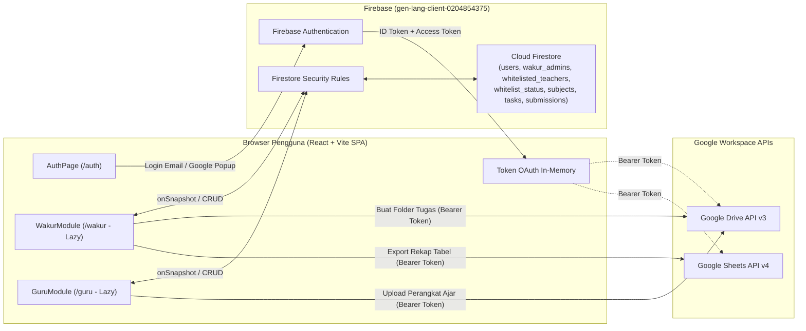
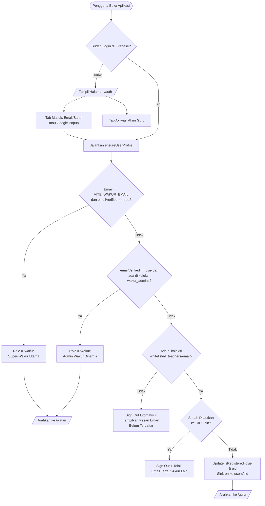
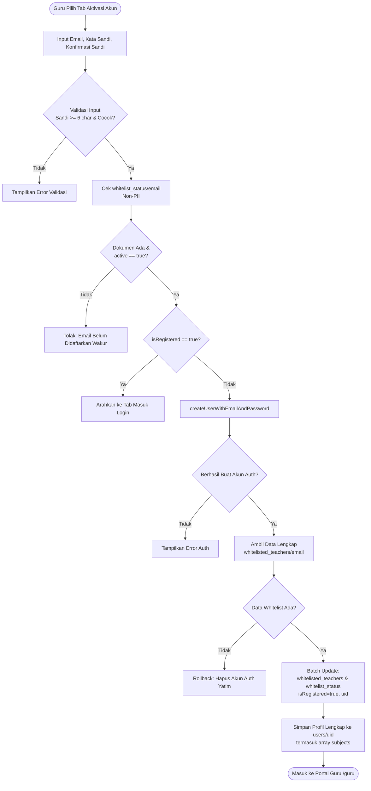
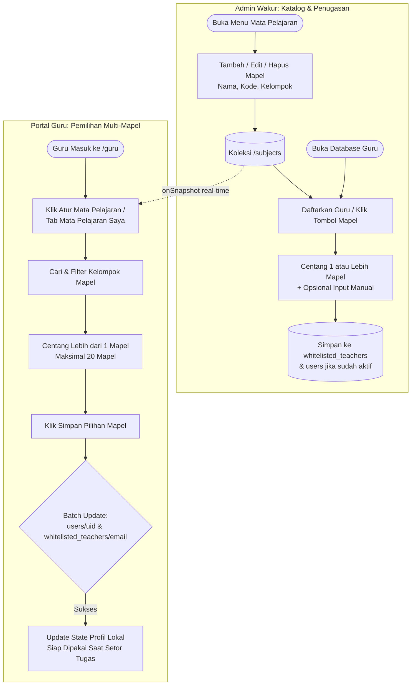
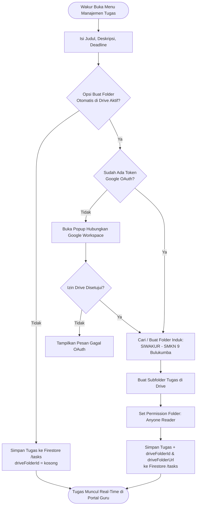
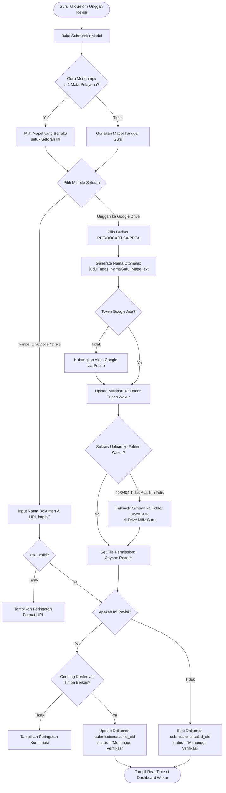
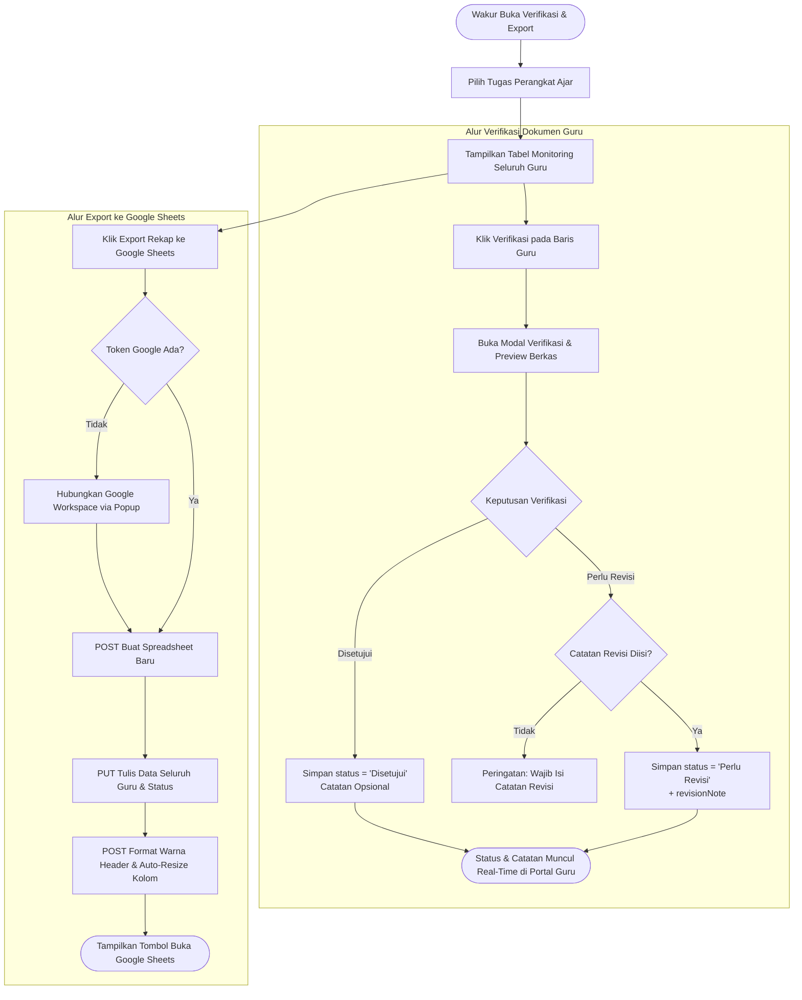
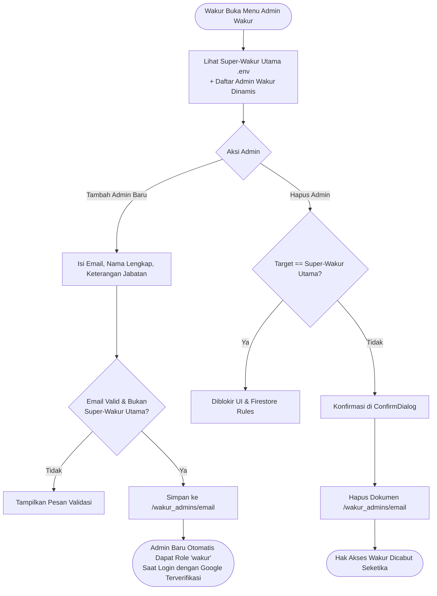

# Flowchart Sistem SIWAKUR
**SMKN 9 Bulukumba — Diagram Alur Sistem & Proses Bisnis**

Dokumen ini berisi seluruh flowchart sistem **SIWAKUR** menggunakan format diagram **Mermaid** yang dapat langsung dirender di GitHub, VS Code, Notion, maupun viewer Markdown modern.

---

## 1. Arsitektur Alur Data Keseluruhan

---

## 2. Flowchart Autentikasi & Penentuan Peran (*Role Resolution*)

---

## 3. Flowchart Aktivasi Akun Guru (Email & Password Baru)

---

## 4. Flowchart Manajemen Mata Pelajaran & Multi-Mapel Guru

---

## 5. Flowchart Manajemen Tugas & Folder Otomatis Google Drive (Wakur)

---

## 6. Flowchart Pengumpulan Perangkat Ajar oleh Guru

---

## 7. Flowchart Verifikasi Dokumen & Ekspor Rekap ke Google Sheets (Wakur)

---

## 8. Flowchart Manajemen Multi-Admin Wakur

